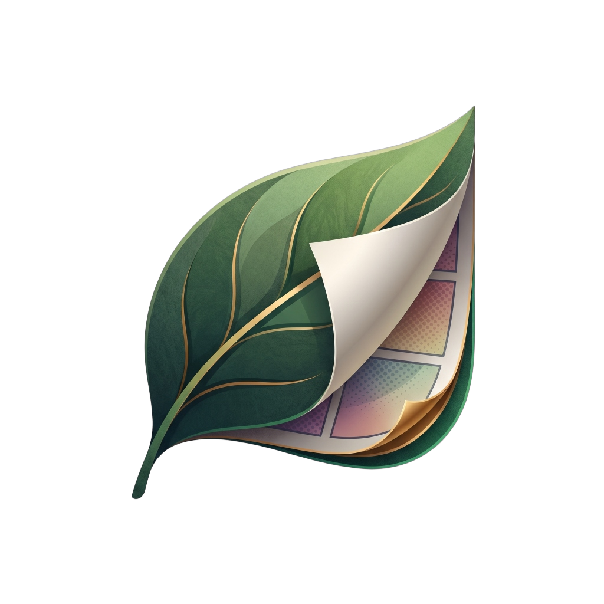

<p align="center">
  
</p>

<p align="center">
  <strong>Leaf</strong> is an immersive, panel-by-panel comic reader for Android built with Kotlin Multiplatform and Jetpack Compose.
</p>

<p align="center">
  <a href="LICENSE"></a>
  
  
</p>

---

## Origin & Upstream Attribution

> [!NOTE]
> **Leaf** is a friendly fork of [**Chika**](https://github.com/batunii/chika) by [Chakra](https://github.com/batunii).
> 
> The core on-device ML panel-detection engine, Kotlin Multiplatform architecture (`:shared`), and distinctive pulp-comic design system (Anton & Archivo typography with halftone ink, crimson, and cream styling) were created by Chakra for Chika. All credit for that foundational work belongs to the upstream project.
> 
> * Upstream Repository: [github.com/batunii/chika](https://github.com/batunii/chika)
> * Original Author: [Chakra (batunii)](https://github.com/batunii)

---

## What makes Leaf special

Tapping through a comic in Leaf steps you **smoothly from panel to panel** in reading order — page &rarr; panel 1 &rarr; panel 2 &rarr; &hellip; &rarr; zoom out &rarr; next page — making reading comfortable on phones, foldables, and tablets without tedious manual pinch-zooming.

### Key Features

- **On-Device ML Panel Detection:** Powered by an on-device YOLO TFLite model trained on Manga109-s; discovers panels and speech bubbles completely offline with zero latency or cloud dependencies.
- **Smart Merge & Split Planner:** Merges tiny adjacent panels for readability and splits wide multi-character spreads with speech-bubble-aware cuts.
- **Interactive 3D Page Curl:** Realistic gesture-driven page curl transition with authentic cylinder deformation, specular highlights, back-page rendering, and shadow depth.
- **Comprehensive Format Support:**
  - **CBZ** (ZIP archives)
  - **CBR** (RAR4 and RAR5 via 7-Zip-JBinding)
  - **PDF** (Native vector and raster page rendering)
- **SMB Network Drive Streaming:** Connect to local Samba / SMB network shares, browse remote directories, and stream or download comics directly.
- **Multi-Select & Batch Import:** Import single comics, multi-select specific titles, or "Select All" to bulk-import whole folders from device storage or remote SMB shares.
- **Adaptive Grid Density:** Seamless column toggling (2, 3, 4, or 6 columns) tailor-made for foldable devices (like Samsung Galaxy Z Fold) and Android tablets.
- **Instant Library Search:** Real-time title search and filtering across your entire comic library.
- **Immersive Full-Screen Reader:** Reader chrome is hidden by default when opening a comic for instant immersion; tap anywhere to reveal scrubbers, reading direction toggles, and panel controls.
- **Reading Progress Sync:** Automatically saves and resumes your exact page **and** panel position per comic.

---

## Architecture

Platform-independent logic is organized in `:shared`, a Kotlin Multiplatform module (JVM & iOS targets) consumed by the `:app` Android frontend:

```
:shared (commonMain — pure Kotlin, unit-tested)
  data/archive   ComicArchive interface · ZipComicArchive · natural page ordering
  detection      Panel model · PanelOrdering (reading order) · PanelPlanner (merge/divide)
  ui/reader      Camera math · panel containment framing · camera lerp transitions

:app (Android Jetpack Compose)
  data/archive   ZipComicArchive (CBZ), RarComicArchive (CBR/RAR5), PdfComicArchive (PDF)
  data/drive     SmbDriveClient · SMB stream provider & background downloader
  data/library   LibraryRepository · multi-select import · Room database persistence
  data/page      PageLoader · downsampled bitmap decoding · LRU memory cache
  detection      MlPanelDetector · TFLite inference · whole-page fallback
  ui/brand       Component kit (wordmark, halftone patterns, starbursts, page coins)
  ui/library     LibraryScreen & LibraryViewModel (grid density, real-time search, batch import)
  ui/reader      ReaderScreen & ReaderViewModel (3D page curl, panel camera, gestures)
  ui/theme       Pulp-comic palette (Ink, Crimson, Cream, Ochre) + Anton/Archivo type
```

**Technology Stack:**
- **Language:** Kotlin 2.0+ (Kotlin Multiplatform)
- **UI:** Jetpack Compose with Material 3
- **Local Database:** AndroidX Room
- **Machine Learning:** TensorFlow Lite (YOLO26n Manga109-s model)
- **Archive Decoding:** Apache Commons Compress, 7-Zip-JBinding-4Android, Android PdfRenderer
- **Network File Sharing:** SMBJ for Samba / SMB 2 & 3 protocol support

---

## Building and Running

Requires **Android Studio** (Koala or newer) with JDK 21 and Android **API 36** (`minSdk 26`, Android 8.0+).

```bash
# Build the debug APK
./gradlew :app:assembleDebug

# Build and install to a connected device or running emulator
./gradlew :app:installDebug
```

On Windows without `java` on `PATH`, point Gradle at Android Studio's bundled JDK:

```powershell
$env:JAVA_HOME = "C:\Program Files\Android\Android Studio\jbr"
.\gradlew.bat :app:installDebug
```

---

## License & Third-Party Notices

Leaf is licensed under the **Mozilla Public License 2.0** — see [`LICENSE`](LICENSE).

Third-party libraries, bundled models, and fonts retain their respective licenses:
- **Chika upstream base:** [batunii/chika](https://github.com/batunii/chika) (MPL 2.0)
- **Panel Detection Model:** [`leoxs22/manga-panel-detector-yolo26n`](https://huggingface.co/leoxs22/manga-panel-detector-yolo26n) (Apache-2.0, trained on Manga109-s)
- **Fonts:** [Anton](https://fonts.google.com/specimen/Anton) and [Archivo](https://fonts.google.com/specimen/Archivo) (SIL Open Font License 1.1)
- **Libraries:** TensorFlow Lite, Apache Commons Compress, 7-Zip-JBinding (LGPL), SMBJ

Detailed license audits and source disclosures are documented in [`THIRD_PARTY_NOTICES.md`](THIRD_PARTY_NOTICES.md).
